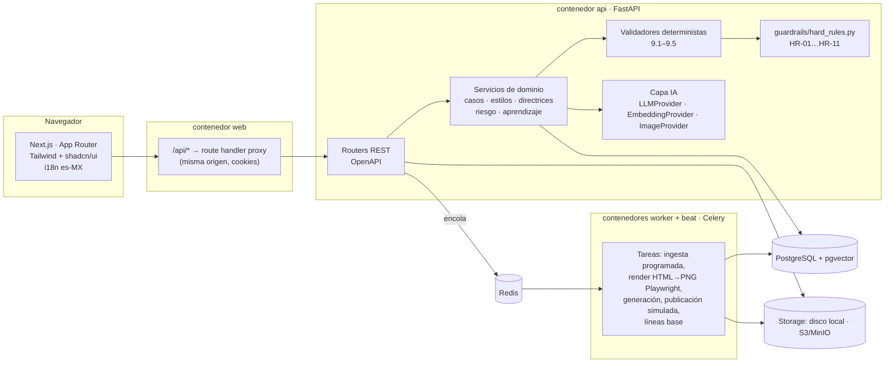
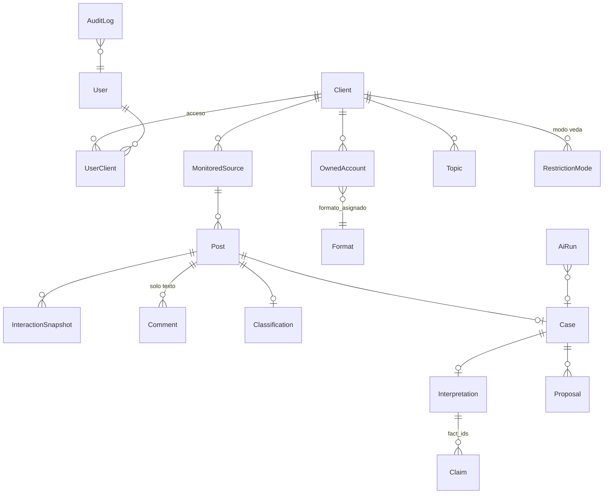
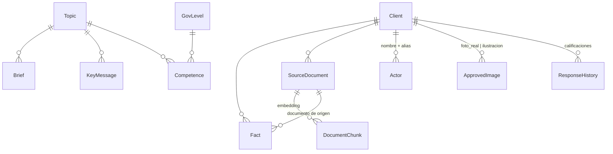
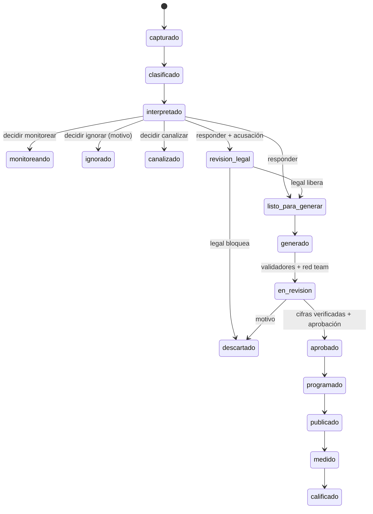

# C-A-R-T-A-A-D · Plan del prototipo beta

Centro de Alerta y Respuesta Temprana a Amenazas Digitales. Prototipo funcional con datos de demostración,
modo mock por defecto (sin llaves externas) y un solo comando de arranque (`docker compose up`).

**Principio rector:** el LLM propone y redacta, el código valida, una persona decide.

---

## 1. Arquitectura



- **Una sola fuente de verdad para reglas duras:** `backend/app/guardrails/hard_rules.py`. Validadores, verificador
  de directrices, copiloto y aprobación las invocan; ninguna configuración las desactiva.
- **Capa IA intercambiable:** `MockProvider` (por defecto, determinista, compone salidas desde `fixtures/` y reglas)
  y `AnthropicProvider` (`ANTHROPIC_API_KEY`, `LLM_MODEL`). Cada paso tiene prompt versionado en `prompts/` y
  esquema en `schemas/` (generado desde Pydantic). Toda llamada queda en `AiRun`.
- **StyleResolver** (código) combina estilo + directrices vigentes con precedencia explícita y produce el
  `style_block` que se inyecta en los prompts, además de la traza de directrices aplicadas.
- **Pieza** = unidad revisable: una variante de copy o un creativo. Ambas comparten validadores, versiones
  (`PieceVersion`), verificación de cifras, revisión legal, aprobación, programación y métricas.
- **Aislamiento multi-cliente:** cada tabla de negocio lleva `client_id`; las plantillas base usan `client_id = NULL`
  y se clonan al crear un cliente. El cliente activo viaja en cookie (`cartaad_client`) y se valida contra los
  accesos del usuario en cada petición.

## 2. Modelo de datos

### 2.1 Núcleo, monitoreo y casos



### 2.2 Base de conocimiento



### 2.3 Estilos, directrices, generación y publicación

```mermaid
erDiagram
  TagDimension ||--o{ Tag : ""
  Client ||--o{ Style : "versión por fila"
  Client ||--o{ Directive : "versión por fila"
  Client ||--o{ CreativeType : "catálogo 7.1"
  Client ||--o{ Format : "catálogo 7.2"
  CreativeType ||--o{ CreativeFormatCompat : "matriz 7.5"
  Format ||--o{ CreativeFormatCompat : ""
  Proposal ||--o{ Piece : "copy | creative"
  Piece }o--|| Style : "estilo_id + versión"
  Piece ||--o{ PieceVersion : "historial + diff"
  Piece ||--o{ FigureCheck : "verificación por cifra"
  Piece ||--o{ RedTeamNote : "informativo"
  Piece ||--o{ Review : ""
  Piece ||--o| ConsentRecord : "A10"
  Piece ||--o{ ScheduledPost : ""
  ScheduledPost }o--|| OwnedAccount : "solo registradas (HR-02)"
  AllyPackage ||--o{ AllyShare : ""
  Piece ||--o{ PostMetrics : "variant_id"
```

Detalles relevantes:

| Entidad | Notas |
|---|---|
| `Style` | Una fila por versión (`slug` + `version`); solo una `activo` por `slug` y cliente. Editar un estilo activo crea un borrador `version+1`. |
| `Directive` | Igual que estilos: `code` (`D-012`) + `version`. Guarda `conflict_status` y `conflict_report`. |
| `Piece` | `kind = copy | creative`; `content` JSON (segmentos o slots), `validation`, `compliance`, `risk_breakdown`, `applied_directives`, `effective_tags`, `adaptation`, `why`, `renders[]`. |
| `Fact` | `value`, `unit`, `base`, `period_label`, `period_start/end`, `document_id`, `valid_until`, `verified_by/at`. |
| `Comment` | Sin autor, sin handle (HR-03). Se sanitiza al ingresar. |

## 3. Máquina de estados del caso



Estados de pieza: `generado → bloqueado | pendiente → aprobado | descartado → programado → publicado`.
El copiloto devuelve la pieza a `generado`, invalida verificaciones y aprobación y revalida.

## 4. Estructura de carpetas

```
CARTAAD/
├── docker-compose.yml        # db, redis, api, worker, beat, web (+ minio opcional)
├── Makefile                  # test, eval, lint, openapi, seed, up
├── prompts/                  # un .md versionado por paso de IA
├── schemas/                  # JSON Schema por paso (generados desde Pydantic)
├── fixtures/mock/            # salidas y reglas del MockProvider (por estilo)
├── evals/                    # casos de evaluación + report.md
├── scripts/                  # seed_sources.py y utilidades
├── docs/                     # PLAN, DECISIONS, DEMO
├── backend/
│   ├── alembic/              # migraciones por milestone
│   ├── app/
│   │   ├── api/              # routers FastAPI
│   │   ├── ai/               # providers, prompts, steps, runner (AiRun)
│   │   ├── adapters/         # SourceAdapter: Mock, FileImport, SocialListening (stub)
│   │   ├── guardrails/       # hard_rules.py (HR-01…HR-11)
│   │   ├── i18n/             # cadenas es-MX del backend
│   │   ├── models/           # SQLAlchemy
│   │   ├── render/           # plantillas HTML/CSS + renderer Playwright
│   │   ├── schemas/          # Pydantic de la API
│   │   ├── seed/             # datos semilla ficticios
│   │   ├── services/         # dominio
│   │   ├── validators/       # 9.1–9.5
│   │   └── worker.py         # Celery app + beat
│   └── tests/
└── frontend/
    └── src/
        ├── app/              # pantallas (App Router)
        ├── components/       # ui (shadcn) + dominio
        ├── i18n/             # es-MX.json
        ├── lib/api/          # cliente + tipos generados desde OpenAPI
        └── styles/tokens.css # tokens de diseño (único archivo)
```

## 5. Milestones

| # | Alcance | Criterio de cierre |
|---|---|---|
| **M0** | Estructura, docker compose, auth (sesión + "Ver como: rol"), roles y permisos, clientes y aislamiento, i18n, tokens de diseño, `AuditLog`, `guardrails/hard_rules.py` con tests HR-01…HR-11. | `pytest` verde, app levanta, login y cambio de cliente. |
| **M1** | Base de conocimiento: hechos (CSV), documentos PDF con chunks + embeddings + búsqueda semántica, briefs, mensajes clave, actores y alias, competencias por nivel, banco de imágenes, historial. | CRUD + búsqueda semántica con tests. |
| **M2** | Etiquetas, estilos (versionado, activación, legal para riesgo alto, import/export, "Probar estilo"), directrices con verificador de conflictos, `StyleResolver`, linter de estilo, matriz creativo × formato, fixtures por estilo, pantalla 12. | Tests de precedencia, rechazo HR, conflictos y linter. |
| **M3** | Fuentes monitoreadas (CRUD, filtros, CSV, 100+), adaptadores, tarea programada, snapshots, línea base y nivel de alerta, captura manual con lectura de imagen y difuminado, webhook stub. | Tests de nivel de alerta y adaptadores. |
| **M4** | Clasificación, interpretación (afirmaciones, comentarios, repetición), estrategia sugerida, puntaje de riesgo, caso con decisión humana, legal, ruteo de quejas. | Tests de reglas de negocio y máquina de estados. |
| **M5** | Copy en variantes de estilo, motor de creativos y render PNG, `ImageProvider`, validadores 9.1–9.5, insignias de fuente, copiloto con versiones y red team. | Tests de validadores adversariales y copiloto. |
| **M6** | Bandeja de aprobación, editor de creativos, verificación por cifra, programación, paquetes para aliados, exportación, modo veda. | Tests HR-02/HR-04/HR-09. |
| **M7** | Métricas, A/B por variante, calificación, `ResponseHistory`, contexto de aprendizaje, `make eval` + `evals/report.md`. | E2E Flujo A y Flujo B verdes. |
| **M8** | Narrativas coordinadas, reporte semanal, pulido, `docs/DEMO.md`, README. | Criterios de aceptación (sección 15 del brief). |

## 6. Estrategia de pruebas

- **Unitarias:** reglas duras, validadores (con casos adversariales), resolver de estilos, verificador de
  directrices, nivel de alerta, puntaje de riesgo, copiloto.
- **API / E2E:** `TestClient` de FastAPI sobre SQLite con Celery en modo eager; recorre Flujo A y Flujo B de punta a
  punta con el `MockProvider`.
- **Evals:** `make eval` corre ~20 casos con el `MockProvider` (regresión) u opcionalmente contra Anthropic.
- **Frontend:** `tsc --noEmit` + `next build` como verificación de tipos contra el esquema OpenAPI.
